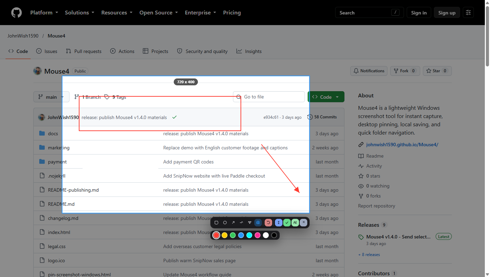

# ShotThink

**Capture. Annotate. Ask.**

A free Chrome extension that sends a browser screenshot to your own ChatGPT
conversation. Capture a region, mark it up, and it lands in a dated chat with
your standing instructions attached.

No desktop app. No API key. No subscription. No per-request billing.

<p align="center">
  
</p>

**[Download v1.0.0](https://github.com/JohnWish1590/ShotThink/releases/download/v1.0.0/ShotThink-1.0.0.zip)** · **[Watch the 30-second demo](docs/demo.mp4)**

---

## Why it is free

ShotThink does not call the OpenAI API. It drives the ChatGPT page you are
already signed in to: it picks the file input, writes the instructions into the
editor, and clicks send.

That means it spends whatever your existing ChatGPT subscription already covers,
instead of billing you per token. There is no key to obtain and nothing to top
up.

The trade-off is that delivery depends on ChatGPT's page structure and on a
background tab staying open. Everything in the design follows from taking that
trade-off seriously — see [Safety](#safety) below.

## What it does

| | |
|---|---|
| **Region capture** | `chrome.tabs.captureVisibleTab`, DPR-aware, so the output matches what is on screen at any display scaling |
| **Annotation** | rectangle, ellipse, arrow, pen, text, mosaic, with undo |
| **Text** | opens where the mouse is, wraps at the selection edge, and draws exactly as it previews |
| **Long capture** | scrolls and stitches by exact `scrollY`; sticky headers suppressed so they do not repeat |
| **Delivery** | one conversation per day, named `YYYY-MM-DD`, later captures appended |
| **Selected text** | right-click → Send to AI, no clipboard reading |
| **Interface** | Chinese and English (follows the browser language, overridable), light/dark/system themes, three toolbar sizes |

## Install

The extension is not on the Chrome Web Store — it automates a third-party site,
which is not a good fit for store review. Install it unpacked:

1. Download [`ShotThink-1.0.0.zip`](https://github.com/JohnWish1590/ShotThink/releases/download/v1.0.0/ShotThink-1.0.0.zip) and unzip it.
2. Open `chrome://extensions/` in Chrome (or any Chromium browser).
3. Turn on **Developer mode** (top right).
4. Click **Load unpacked** and select the unzipped folder.
5. Sign in to [chatgpt.com](https://chatgpt.com) in the same browser profile.

Then click the toolbar icon or press <kbd>Alt</kbd>+<kbd>Shift</kbd>+<kbd>S</kbd>.

> `Ctrl+Shift+S` is reserved by Chrome for "Save page as", so it cannot be used.
> To change the shortcut, visit `chrome://extensions/shortcuts`.

**Requirement:** a Chromium browser. Firefox is not supported — the extension
relies on `captureVisibleTab` and `scripting` as implemented in Chromium.

## Usage

1. **Select** — click the toolbar icon or press the shortcut, then drag out a
   region. The toolbar appears under the selection.
2. **Annotate** — pick a tool and draw. Colours and font size are remembered
   between captures.
3. **Send** — the green **AI** button saves the image, queues it, and delivers it
   to today's conversation. The green **✓** saves and copies to the clipboard
   instead, and **📌** is not present because a web page cannot pin a window to
   the desktop.

The ChatGPT tab that performs delivery stays in the background. You do not need
to keep it in front, but it must stay open.

### Long capture

Click **⤓** in the toolbar. The page scrolls itself, samples each viewport, and
stitches them into one tall image, then puts it back in the editor so you can
annotate and send it like any other capture.

Two limits worth knowing:

- `captureVisibleTab` is throttled to about two calls per second, so a very long
  page takes a few seconds.
- Feeds that destroy off-screen nodes (infinite-scroll timelines) cannot be
  captured completely, because the content no longer exists by the time the
  capture reaches it.

### Settings

Open the options page from `chrome://extensions/` → **Details** → **Extension
options**, or by right-clicking the toolbar icon.

- **Analysis instructions** — the text attached to every capture. Available in
  both languages, switchable independently of the interface language. Once you
  edit them, a language switch will not overwrite your text.
- **Toolbar size** — 22 / 26 / 31 px.
- **Send history** — status of every capture, with a link to its conversation.

## Safety

These are not edge cases that were bolted on; they are the reason the tool is
usable.

- **A send whose outcome is unknown is never retried automatically.** It is
  marked *uncertain* and you check the conversation. A duplicate screenshot in
  your chat is worse than asking you to look.
- **An existing draft is never overwritten.** If the composer has text in it,
  the send stops.
- **A generating answer is never interrupted.** The queue waits for it to finish.
- **Restricted pages are detected before injection.** `chrome://`, the Web Store,
  the PDF viewer, and the extension's own pages cannot be captured; the tool says
  so instead of failing silently.

When something does go wrong, the toolbar icon shows a red **!** and the
diagnostics page (`options` → *Capture will not start?*) explains why.

## Permissions

| Permission | Why |
|---|---|
| `activeTab` | Capture and annotate only the tab you explicitly invoke it on. Granted by your click or shortcut — never standing access to every site. |
| `scripting` | Inject the overlay into that tab |
| `storage` | Queue metadata, daily-chat mapping, settings |
| `contextMenus` | The "Send to AI" item for selected text |
| `alarms` | Settle jobs whose page died mid-send |
| `host_permissions: chatgpt.com` | Upload the image and press send on your behalf |

No `<all_urls>`. No `debugger`. No cookie access. No network requests other than
those the ChatGPT page makes itself.

Images are stored in IndexedDB, not `chrome.storage.local`: the latter is capped
at 10 MB and holds only text, which would fit about seven screenshots and not
even one long capture.

## How it works

```
toolbar icon / Alt+Shift+S
        │
        ▼
captureVisibleTab ──► frozen bitmap (device pixels)
        │
        ▼
overlay canvas ──► region select + annotations
        │
        ▼
IndexedDB (image) + chrome.storage.local (metadata)
        │
        ▼
background queue ──► content script on chatgpt.com
        │              (upload, insert instructions, click send)
        ▼
dated conversation, named YYYY-MM-DD
```

The delivery half is ported from [Mouse4](https://github.com/JohnWish1590/Mouse4),
a Windows screenshot tool by the same author. Reading its source showed that the
delivery logic was already a Chrome extension; only capture and annotation were
desktop-bound. ShotThink replaces the capture source and drops the native
messaging bridge.

Design notes, risks, and milestones: [docs/DESIGN.md](docs/DESIGN.md).
What was deliberately dropped versus the desktop tool: [docs/SCOPE.md](docs/SCOPE.md).
中文说明: [docs/README.zh.md](docs/README.zh.md).

## Development

No build step. Edit the files and reload the extension in `chrome://extensions/`.

```
manifest.json
src/
  background.js   queue, daily routing, capture dispatch
  capture.js      captureVisibleTab wrapper, DPR, long capture, sticky suppression
  overlay.js      region select, annotations, toolbar, text editor
  store.js        IndexedDB image store
  daily.js        one conversation per day
  sender.js       drives the ChatGPT page
  i18n.js         zh/en strings
  rules.js        default analysis instructions
ui/
  options.html    settings and send history
  diagnose.html   "why did nothing happen"
tests/            111 cases, no dependencies
```

Run the tests:

```bash
node tests/store.test.mjs     # IndexedDB layer, base64 chunking, migration
node tests/overlay.test.mjs   # selection, toolbar placement, stitching, mosaic
node tests/queue.test.mjs     # settlement, handoff, no-duplicate-retry
node tests/ui.test.mjs        # visibility, sizing, shortcut, i18n, rename
```

Every user-visible change must bump `manifest.json`. Chrome only reloads an
unpacked extension's code when that number changes. Version numbers follow
[Semantic Versioning](https://semver.org/); see [CHANGELOG.md](CHANGELOG.md).

## License

MIT — see [LICENSE](LICENSE).

---

Sibling project: [ClipThink](https://github.com/JohnWish1590/clipthink) thinks
about what you copy. ShotThink thinks about what you see.
